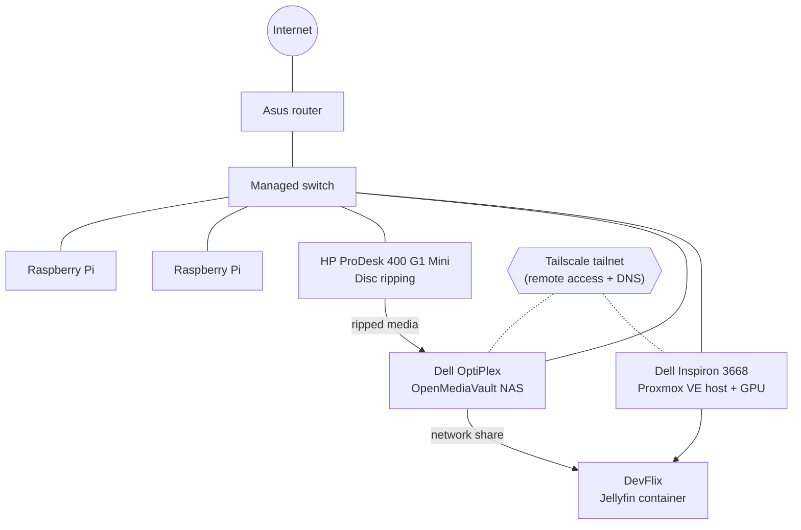

# 🏠 Homelab

A self-hosted home infrastructure built from repurposed desktops and Raspberry Pis. It runs a virtualization host, a dedicated network storage box, a disc-ripping workstation, and **DevFlix**, a Jellyfin media server for my Blu-ray, DVD, and digital movie collection. Everything is reachable remotely and securely through Tailscale.

> 📸 Screenshots and photos coming soon. See [`docs/`](docs/) for build notes.

## Goals

- Digitize a physical movie and TV collection and stream it anywhere
- Keep **storage separate from compute** so a VM rebuild never puts media at risk
- Learn virtualization, networking, and Linux administration hands-on
- Remote access without opening ports on the router

## Architecture



## Hardware

| Machine | Role | Notes |
|---|---|---|
| Dell Inspiron 3668 | Proxmox VE hypervisor | Has a dedicated graphics card for media transcoding |
| Dell OptiPlex | OpenMediaVault NAS | Storage only; shares media over the network |
| HP ProDesk 400 G1 Desktop Mini (Core i3) | Ripping station | Rips Blu-rays and DVDs, then copies to the NAS |
| Raspberry Pi × 2 | Lightweight services | Reserved for always-on utilities |
| Managed switch | LAN backbone | Plugged into the router; VLANs on the roadmap |
| Asus router | Gateway | Home LAN |
| Spare 2 TB + 1 TB HDDs | Expansion | To be added to the storage pool |

## Services

| Service | Runs on | Purpose |
|---|---|---|
| **Proxmox VE** | Inspiron 3668 | Hosts VMs and containers |
| **OpenMediaVault** | OptiPlex | Network storage for the media library |
| **Jellyfin ("DevFlix")** | Proxmox container | Streams the library, reading from the OMV share |
| **Tailscale** | Nodes on the tailnet | Private remote access and DNS without port forwarding |

## Design decisions

**Why a separate NAS?** Keeping media on its own machine means I can rebuild, snapshot, or break Proxmox guests without touching the library. The Jellyfin container just mounts the share.

**Why Tailscale?** It gives each machine a stable private address and name from anywhere, with no open ports on the home router.

**Why a dedicated ripping box?** Ripping is slow and disk-heavy. Offloading it to the ProDesk keeps the hypervisor free for streaming and other services.

## Roadmap

- [ ] Add the spare 2 TB and 1 TB drives to the NAS
- [ ] Set up VLANs on the managed switch (separate lab, media, and home traffic)
- [ ] Enable GPU hardware transcoding for Jellyfin
- [ ] Put the Raspberry Pis to work (monitoring, DNS, or backups)
- [ ] Automated backups for Proxmox guests and NAS config
- [ ] Add screenshots and a photo of the rack

## Repo layout

```
homelab/
├── README.md          ← you are here
└── docs/
    ├── build-log.md   ← dated notes as the lab evolves
    └── jellyfin.md    ← how DevFlix is set up
```
